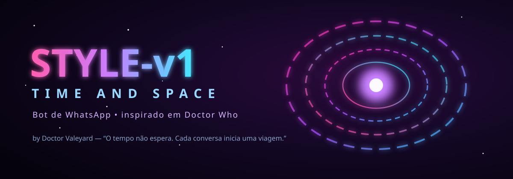
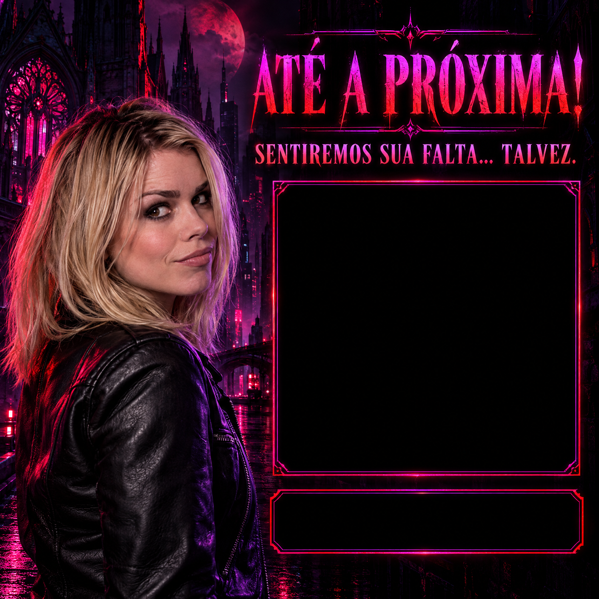

<!-- ═══════════════════════════════════════════════════════════════ -->
<!--                   🌀  S T Y L E - v 1  •  TIME AND SPACE          -->
<!-- ═══════════════════════════════════════════════════════════════ -->

<div align="center">



<br/>

<a href="https://whatsapp.com/channel/0029VbEHp6CFHWpymLOJGZ28">
  
</a>

<br/><br/>


<br/>

> ### *“O tempo não espera. As linhas temporais mudam. E cada conversa pode iniciar uma nova viagem.”*

</div>

---

## 🌀 O que é o STYLE-v1

**STYLE-v1** é um bot de WhatsApp multifuncional com uma identidade própria inteirinha no universo de **Doctor Who** — a personalidade é a **Rose Tyler**: inteligente, corajosa, espontânea e com aquele toque de ironia. Não é "um bot com umas referências": cada mensagem, botão, reação, saudação, entrada, saída e painel foi pensado como se o grupo estivesse conversando com uma tecnologia temporal.

<div align="center">

<table>
  <tr>
    <td align="center"><br/><b>STYLE-v1</b></td>
    <td align="center"><br/><b>Chegada de um viajante</b></td>
    <td align="center"><br/><b>Salto temporal (saída)</b></td>
  </tr>
</table>

</div>

---

## ✨ Destaques

| 🌌 Recurso | O que faz |
|---|---|
| 🌀 **RPG Temporal** | Crie um viajante (Senhor do Tempo, Companheiro, Dalek, Cyberman, Guardião da TARDIS), compre **vestuário** na loja temática, batalhe no grupo e numa **arena global que cruza TODOS os grupos**. Ranking do multiverso incluso. |
| 💬 **Saudação inteligente (texto)** | Sem áudio. Um **motor combinatório** com **+118 mil** mensagens únicas no tom da Rose — entende abreviação, gíria da geração Z, erro de digitação e letra repetida (`bd`, `vlw`, `blz`, `kkk`, `vsf`…). Liga/desliga com `saudacao`. |
| 🎵 **Música robusta** | Baixa com **3 métodos em paralelo** (Savetube, Vreden, YouTube direto) **+ yt-dlp** que **se instala e se atualiza sozinho**. Sem tempo de espera: quem baixar primeiro ganha. |
| 🪄 **Reações temáticas** | O bot reage com 🌀 ⏳ 🚀 💫 🔮 ⚡ 🛸 conforme a situação. |
| 🎴 **Cards de entrada/saída** | Boas-vindas e despedidas em arte Doctor Who, com a foto e o número da pessoa encaixados no molde. |
| 🖼️ **Figurinhas & conversão** | Figurinha, GIF, imagem, ATTP, nome na foto — com frasezinha temática na conversão. |
| 🛡️ **Segurança** | Antilink, antifake, antinudes (IA), antispam, antiflood, antitrava, lista negra e mais. |
| 💰 **Economia & jogos** | Ouro, loja, duelo, roleta, ranking, perfil, e vários joguinhos. |
| 👑 **Dono manda em tudo** | O dono executa **qualquer** comando mesmo sem ser admin do grupo (o bot reconhece o dono automaticamente). |

---

## 🚀 Como instalar no Termux

> 📌 **Antes de começar:** troque o endereço do repositório abaixo pelo **seu** link do GitHub.

### 1️⃣ Baixar o bot (criar a pasta e copiar o repositório dentro dela)

```bash
pkg install -y git
git clone https://github.com/DOCTOR-VALEYARD/STYLE-v1.git STYLE-v1
cd STYLE-v1
```

### 2️⃣ Instalar tudo (Node, ffmpeg e as dependências)

```bash
bash instalar.sh
```

> Isso instala o Node, o git, o ffmpeg e roda o `npm install`. Faz **uma vez só**.

### 3️⃣ Iniciar o bot

```bash
bash iniciar.sh
```

Leia o **QR Code** (ou use o código de pareamento) com o WhatsApp e pronto — a TARDIS está no ar. 🌀

---

## 🔁 Comandos do dia a dia

| Situação | Comando |
|---|---|
| ▶️ **Iniciar o bot** | `bash iniciar.sh` |
| 🔄 **Reabrir depois de fechar o Termux** (sem baixar de novo) | `cd STYLE-v1 && bash iniciar.sh` |
| ⬆️ **Atualizar** quando sair uma versão nova | `cd STYLE-v1 && git pull && npm install && bash iniciar.sh` |
| 🧰 **Reinstalar dependências** (se der erro) | `cd STYLE-v1 && npm install` |

> 💡 O `iniciar.sh` **reinicia sozinho** se o bot cair, então é só deixar rodando.

<details>
<summary>🍪 Cookies do YouTube (opcional)</summary>

O bot baixa música **sem precisar de cookies**. Mas se você quiser passar por vídeos com restrição de idade/login, é só colocar um arquivo **`cookies.txt`** na raiz do bot (dentro da pasta `STYLE-v1`). Ele usa automaticamente — e se não tiver, funciona do mesmo jeito.
</details>

---

## 🧬 RPG Temporal — comece rápido

```
rpg                  → abre o painel (card)
rpg classes          → ver as 5 classes
rpg criar <classe>   → cria seu viajante
rpg loja             → vitrine de vestuário temático
rpg batalhar @alguém → duelo no grupo
rpg arena            → entra na central global (entre grupos)
rpg desafiar <cód>   → luta com gente de outros grupos
rpg ranking          → os maiores do multiverso
```

*(todos os comandos do RPG são liberados — qualquer pessoa joga.)*

---

## 🛠️ Requisitos

- **Node.js** `>= 20`
- **git** e **ffmpeg** (o `instalar.sh` já resolve)
- Android com **Termux**, ou qualquer hospedagem Node (Pterodactyl / LordeHost, etc.)

---

<div align="center">

## 👑 Criado por **Doctor Valeyard**

[](https://whatsapp.com/channel/0029VbEHp6CFHWpymLOJGZ28)
[](https://instagram.com/__dvcl__)
[](https://wa.me/5516998761099)

📧 **devanilsonfrancisco36@gmail.com**

<br/>


**🌀 STYLE-v1 — TIME AND SPACE 🌀**

</div>
